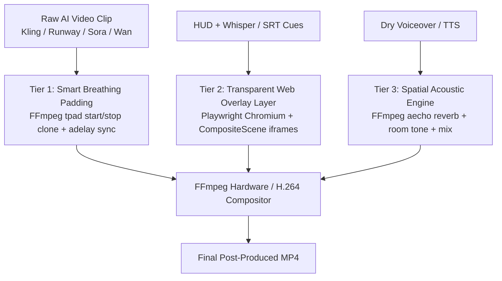

<div align="center">

# 🎬 web-video-creator

**Code-as-Video Rendering & Three-Tier AI Video Post-Production Engine**

*Don't let generative video models hallucinate distorted text and jittery UIs. Let HTML5/CSS3, Playwright, and FFmpeg handle deterministic post-production.*

[](https://github.com/liusc007/web-video-creator/actions/workflows/ci.yml)
[](https://www.python.org/downloads/)
[](LICENSE)
[](#architecture)

[English](README.md) · [简体中文](README_ZH.md) · [AI Post-Production Field Guide](docs/AI_POST_PRODUCTION_GUIDE.md)

</div>

---

## Why `web-video-creator`?

Generative video models (Kling, Runway, Sora, Wan, etc.) are great at lighting, camera mood, and physical acting — **not** pixel-accurate UI, readable typography, frame-exact pacing, or spatial room acoustics.

Instead of fighting brittle pixel-drawing scripts or letting diffusion models mangle subtitles and HUD boxes, **`web-video-creator` treats the web browser as a deterministic cinema compositor**:

| Pain Point in AI Video | Prompting the Video Model Directly | `web-video-creator` Pipeline |
| :--- | :--- | :--- |
| **HUD / Security Cam / UI** | Garbled characters, warping borders, flickering timestamps | **Transparent HTML5/CSS3 Overlays** (`CCTVScene`, `CyberHUDScene`, `HUDScene`) with deterministic millisecond clocks |
| **Bilingual Subtitles** | Misspelled text burned permanently into pixels | **`TimedSubtitleScene`** driven by Whisper JSON / SRT with word-level karaoke highlighting |
| **Abrupt Clip Cuts** | Actors speak at `0.1s` and cut off mid-syllable | **Smart `tpad` Breathing Padding** clones start/end frames while keeping audio synced (`adelay`) |
| **Flat "Studio" TTS Audio** | Dry narration feels pasted onto cavernous scenes | **`AudioProcessor`** applies spatial reverb (`hall`, `cathedral`, `cctv_speaker`) + synthesized room tone |
| **CSS Animation Drift** | Frame capture lag desyncs animations | **Frame-Locked WAAPI** (`document.getAnimations()` + `--hf-progress`) steps every frame deterministically |

---

## Architecture



```text
┌──────────────────────────────────────────────────────────────────────┐
│ Tier 1 · Raw AI Video Layer                                          │
│   Clean text-free video + FFmpeg tpad frame-cloned breathing margins │
├──────────────────────────────────────────────────────────────────────┤
│ Tier 2 · Transparent Web Overlay Layer (Playwright + CSS3/SVG)       │
│   CompositeScene stacks isolated full-viewport layers:               │
│   - CCTVScene / CyberHUDScene / HUDScene (5 themes, live timecode)   │
│   - TimedSubtitleScene (Whisper word-level JSON / SRT, +tpad offset) │
├──────────────────────────────────────────────────────────────────────┤
│ Tier 3 · Spatial Audio Layer (FFmpeg Acoustics)                      │
│   Scene reverb (hall/cathedral/corridor/cctv_speaker/radio)          │
│   + synthesized room tone + transition static clicks                 │
└──────────────────────────────────────────────────────────────────────┘
```

---

## Installation

> **Prerequisite:** [FFmpeg](https://ffmpeg.org/download.html) (`ffmpeg` & `ffprobe`) available on `PATH`.

```bash
git clone https://github.com/liusc007/web-video-creator.git
cd web-video-creator
pip install -e .
playwright install chromium
```

---

## Quick Start

### 1. Command Line (`wvc`)

```bash
# Render a standalone HTML file or text card into 1080p MP4
wvc render examples/sample.html -o sample.mp4 -d 5.0
wvc --text "Powered by Code" -o title.mp4 -d 3.0

# Tier 1: Add natural breathing margins to an abrupt AI clip
wvc pad --video raw_ai_clip.mp4 -o padded.mp4 --start 0.35 --stop 0.50

# Tier 2: Composite a transparent CCTV or Cyber HUD (+ optional SRT subtitles)
wvc overlay --video padded.mp4 --type cctv --theme emerald \
  --title "CAM-07 [SANCTUARY]" --srt dialogue.srt -o overlaid.mp4

# Tier 3: Give dry TTS dialogue spacious hall acoustics
wvc audio --input dry_voice.mp3 --preset hall --fade-out 0.08 -o hall_voice.aac

# All-in-One: Build all 3 tiers from a declarative project config
wvc build examples/project_example.json -o final_cut.mp4

# List all HUD and acoustic presets
wvc presets
```

### 2. Python Async API

```python
import asyncio
from web_video_creator import (
    AudioProcessor,
    CCTVScene,
    CompositeScene,
    HTMLToVideo,
    TimedSubtitleScene,
)


async def main():
    # 1. Pad abrupt AI clip boundaries
    HTMLToVideo.apply_smart_padding(
        "raw_clip.mp4", "padded.mp4", start_duration=0.35, stop_duration=0.50
    )

    # 2. Stack transparent CCTV HUD + Whisper-aligned bilingual subtitles
    hud = CCTVScene(
        title="CAM-07 [MAIN_SANCTUARY]",
        location="INNER HALL // 35° DOWN",
        color_theme="emerald",
        targets=[
            {
                "x": 36, "y": 24, "w": 28, "h": 50,
                "label": "SUBJECT-01",
                "confidence": "99.8%",
                "metrics": {"PULSE": "142 BPM", "STATUS": "LOCKED"},
            }
        ],
        duration=4.5,
    )
    subs = TimedSubtitleScene.from_whisper(
        {"segments": [{"start": 0.1, "end": 3.4, "text": "所有 UI 与双语字幕，全部由代码精准合成。"}]},
        translation_map={0: "All HUDs and bilingual subtitles rendered deterministically in code."},
        offset=0.35,  # Matches start_duration padding
        style="cinema",
        duration=4.5,
    )
    composite = CompositeScene(layers=[hud, subs])

    # Automatically adapts to 16:9, 9:16 vertical, or 4K base video dimensions
    converter = HTMLToVideo(fps=30)
    await converter.overlay_scenes_on_video("padded.mp4", [composite], "overlaid.mp4")

    # 3. Ground dry audio in hall reverb + synthesized room tone
    AudioProcessor.generate_room_tone("room_tone.aac", duration=5.0, tone="hall")
    AudioProcessor.mix_dialogue_and_ambience(
        "dry_voice.mp3", "room_tone.aac", "spatial.aac",
        dialogue_delay=0.35, dialogue_preset="hall",
    )
    HTMLToVideo.add_audio("overlaid.mp4", "spatial.aac", "final_cut.mp4")


asyncio.run(main())
```

---

## Built-in Presets

- **Overlay Scenes:** `CCTVScene`, `CyberHUDScene` (rotating SVG radar + scan beam), `HUDScene`, `SubtitleScene`, `TimedSubtitleScene` (Whisper JSON & `.srt`), `CompositeScene`, `TextScene`, `ImageScene`
- **HUD Color Themes:** `emerald`, `amber`, `cyan`, `crimson`, `monochrome`
- **Subtitle Styles:** `cinema` (frosted glass), `netflix` (clean drop shadow), `neon` (cyber glow), `cctv` (terminal monospace)
- **Spatial Audio Presets:** `hall`, `cathedral`, `room`, `corridor`, `cctv_speaker`, `radio`, `none`

---

## Project Structure

```text
web-video-creator/
├── web_video_creator/
│   ├── scene.py          # Responsive HTML5/CSS3 scenes, HUDs, timed subtitles, CompositeScene
│   ├── converter.py      # Playwright frame-locked capture + FFmpeg tpad / overlay / probe / concat
│   ├── audio.py          # Spatial reverb presets, room-tone synthesis, transition SFX
│   ├── pipeline.py       # Three-tier JSON/YAML declarative build pipeline
│   └── cli.py            # `wvc` CLI (render / overlay / pad / audio / build / presets)
├── docs/
│   └── AI_POST_PRODUCTION_GUIDE.md
├── examples/
│   ├── cctv_ai_post_production.py
│   ├── project_example.json
│   ├── demo.py
│   └── sample.html
└── tests/
```

---

## Contributing & License

Contributions are welcome! Please read [CONTRIBUTING.md](CONTRIBUTING.md) before opening a Pull Request.

Released under the [MIT License](LICENSE).
